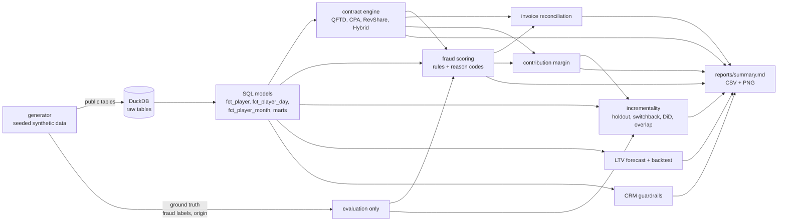
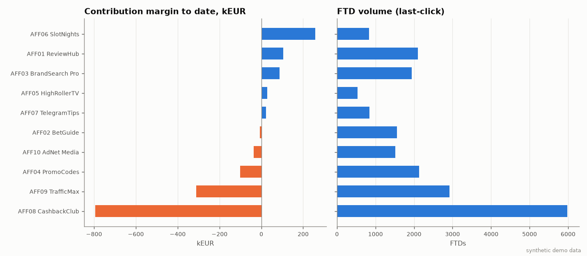
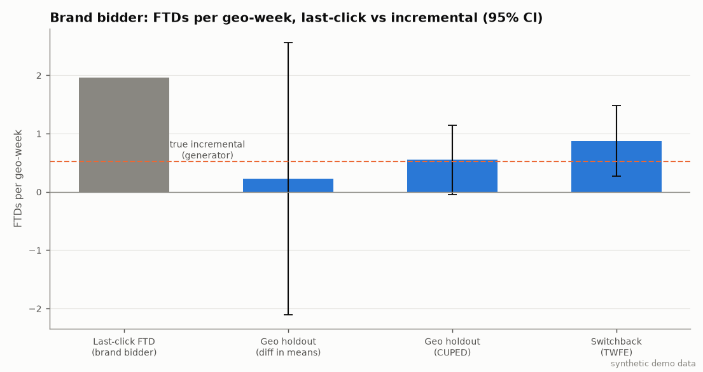
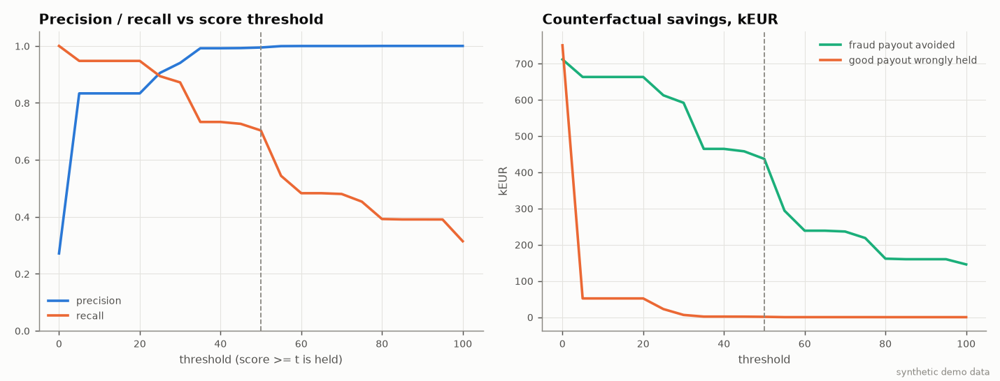

# affiliate-measurement-stack

Аналитический стек для affiliate-канала iGaming-оператора: единая event-схема click → registration → KYC → FTD → bet → NGR, движок партнёрских контрактов (CPA / RevShare / Hybrid) с месячными инвойсами, contribution margin по партнёрам и когортам, incrementality (geo holdout, switchback, DiD), прогноз LTV с backtest, интерпретируемый fraud scoring с симуляцией порога, сверка партнёрских инвойсов и CRM guardrails.

> **Данные синтетические.** Все таблицы порождает сидированный генератор (`affmeasure.generator`). Это демонстрационный датасет с заранее заложенными механизмами (перехват brand-трафика, coupon last-click, мотивированный трафик, бот-фермы, bonus abuse). Числа ниже показывают, что методы работают и что они находят заложенные эффекты. О реальном рынке, операторах или партнёрах они ничего не говорят.

**Стек:** Python 3.12, uv, DuckDB (SQL-модели), pandas, NumPy, SciPy, matplotlib, pytest, ruff, GitHub Actions.

## Быстрый старт

```bash
uv sync
uv run affmeasure run            # ~1 мин: генерация → DuckDB → анализ → reports/
uv run pytest                    # 47 тестов
uv run ruff check .
```

Флаги CLI: `--seed 42`, `--scale 0.3` (меньше данных), `--out reports`, `--no-export` (без parquet, DuckDB в памяти).
Результат: `reports/summary.md`, CSV-выгрузки (инвойсы, CM, review queue, сверка, CRM-экспорт) и PNG-графики в `reports/charts/`. Parquet (`data/raw/`, отдельно `data/ground_truth/`) и `data/warehouse.duckdb` в git не попадают.

## Pipeline



Скоринг и SQL-модели видят только то, что было бы у оператора. Метки фрода и истинное происхождение игроков в DuckDB не загружаются: pipeline использует их только на шаге оценки (precision/recall, сравнение с истинным эффектом).

### Модули

| Модуль | Что делает |
|---|---|
| `generator.py` | 10 партнёров шести типов (SEO, brand bidding, coupon, streamer, tipster, media) плюс incentivised и bot farm, organic; клики с `click_id`/`sub_id`, touchpoints, KYC, депозиты, player-day ставки, выводы, chargebacks, бонусы, CRM-согласия, self-exclusion, история рассылок, partner reports с расхождениями; geo × week дизайн эксперимента для brand bidder |
| `sql/*.sql` | `fct_player` (атрибуция по трекинговому клику, воронка), `fct_player_day`, `fct_player_month`, `mart_funnel`, `mart_cohort_windows` (D7/D30/D90), `mart_ltv_curve` (+ retention), `mart_chargebacks` |
| `contracts.py` | QFTD (min deposit, min wagering, KYC, окно N дней, PENDING), CPA с месячным cap, RevShare (tiers по FTD или net revenue, negative carryover on/off, admin fee, provider deductions, player lifetime), Hybrid, инвойсы и аллокация выплат по игрокам |
| `margin.py` | CM на игрока, партнёра, когорту; to-date и фиксированное окно D90 |
| `incrementality.py`, `stats.py` | Welch и CUPED, TWFE с cluster-robust SE, DiD с pre-trend тестом и event study, overlap каналов |
| `ltv.py` | power-decay fit, chain ladder, backtest с as-of отсечкой |
| `fraud.py` | 7 правил с reason codes, weighted score, threshold simulation, counterfactual savings, review queue |
| `reconciliation.py` | классификация претензий партнёра по причинам расхождения |
| `crm.py` | self-exclusion, cool-off, consent (fail closed), частотные лимиты, минимальный интервал между контактами |

## Формулы

**NGR** в этом репозитории: `NGR = GGR − gaming tax − provider/game fees`. Бонусы идут отдельной строкой, чтобы не вычесть их дважды.

**Contribution margin:**

```
CM = NGR − affiliate payout − bonus cost − payment cost − chargebacks − variable ops
payment cost  = card 2.5% + 0.20 | e-wallet 3% | open banking 0.50  на депозит, + 1.00 на вывод
chargebacks   = сумма chargeback + 15 fee
variable ops  = 1.50 × KYC-попыток + 2.00 × активных месяцев
```

**CPA:** игрок квалифицирован (QFTD), если в пределах `within_days` от регистрации выполнены все условия: `Σ deposits ≥ min_deposit`, `Σ stake ≥ min_wagering`, пройден KYC. Момент квалификации — самое позднее из трёх событий, выплата относится к месяцу квалификации. Сверх `monthly_cap` QFTD не оплачиваются (очерёдность по времени).

**RevShare** (по месяцам):

```
net_revenue_player = GGR − gaming tax − bonus cost − chargebacks − provider fees*   (* если deduct_provider_fees)
                     только месяцы с months_since_reg < player_lifetime_months
gross   = Σ net_revenue_player
admin   = admin_fee × gross, если gross > 0, иначе 0
net     = gross − admin + carryover_in
payable = rate(tier) × net, если net > 0, иначе 0
carryover_out = net, если net ≤ 0 и negative_carryover, иначе 0
rate(tier): ставка максимального tier с threshold ≤ basis (FTD за месяц или net revenue); граница включительна
```

**Hybrid** = CPA + RevShare по тем же правилам. Выплата RevShare распределяется по игрокам пропорционально их net revenue, так что сумма по игрокам совпадает с инвойсом.

## Результаты (seed 42, synthetic)

Масштаб: 65 497 регистраций за 52 недели (с 2025-01-06), активность до 2026-03-31, 367 598 кликов, 193 224 депозита, 40 гео. Полный отчёт: [`reports/summary.md`](reports/summary.md).

**Высокий FTD volume при отрицательной марже.** У CashbackClub (AFF08, incentivised) больше всего FTD среди партнёров: 5 984. При этом CM = −793 781 EUR, то есть −133 EUR на FTD. NGR на FTD 3.7 EUR против CPA-выплаты 103 EUR на FTD и бонусов 27 EUR на FTD. Если удержать выплаты по игрокам, которых отметил fraud scoring, CM остаётся −507 581 EUR: остальные игроки этого партнёра формально чистые, но низкоценные. Бот-ферма TrafficMax (AFF09) даёт 2 919 FTD и −312 011 EUR CM при chargeback rate 32.5% депозитов.



**Last-click и инкрементальность.** Brand bidder (AFF03) по last-click получает 1 936 FTD при CPA-выплате 117 150 EUR (60.5 EUR на FTD) и выглядит прибыльным: CM +87 996 EUR. У 74.3% его FTD был organic brand-search touchpoint в предыдущие 30 дней.

| Дизайн | Эффект, FTD на geo-week (95% CI) | Incremental share |
|---|---|---|
| Last-click | 1.96 | 100% |
| Geo holdout, diff in means | 0.22 [−2.11; 2.56] | — |
| Geo holdout, CUPED | 0.55 [−0.05; 1.14], p = 0.069 | 28% |
| Switchback, TWFE | 0.87 [0.26; 1.48], p = 0.006 | 38% |
| Истина генератора | — | 26% |

При incremental share 28–38% стоимость инкрементального FTD 160–217 EUR вместо 60.5, а CM канала в инкрементальном взгляде от −40 до −60 тыс. EUR вместо +88 тыс. Holdout на 40 гео без CUPED ничего не показывает: разброс между гео слишком велик. Pre-period ковариата сужает CI примерно в 4 раза. Switchback на тех же гео мощнее.

DiD (неслучайный ранний запуск в 12 крупнейших гео): ATT 1.51 [1.05; 1.98] FTD на geo-week, то есть около 40% last-click. Pre-trend тест (p = 0.75) и joint test leads (p = 0.26) параллельность трендов не отвергают, но оценка выше истины: истинный эффект около 1.0, ровно у нижней границы CI. Прошедший pre-trend тест не доказывает причинность, поэтому для решений основной выступает рандомизированный дизайн.



**Контракты.** Стример HighRollerTV (AFF05) работает по RevShare 40% без negative carryover. После крупного выигрыша игрока в апреле 2025 net revenue месяца составил −78 828 EUR. Без переноса партнёр уже в мае снова получает выплаты. What-if с carryover = on: 56 059 EUR выплат вместо 87 591, разница 31 531 EUR. У SlotNights (AFF06, Hybrid, carryover on) минус −23 566 EUR в марте погашает апрельский плюс.

**LTV backtest** (cumulative NGR/FTD на M5 по первым 3 месяцам, 5 когорт, без look-ahead):

| Модель | MAPE | Bias |
|---|---|---|
| observed so far | 15.8% | −15.8% |
| power decay (fit по когорте) | 10.8% | +10.8% |
| chain ladder (as-of) | 3.8% | −1.3% |

Power decay неустойчив к выбросам: один месяц с джекпотом в ранних возрастах когорты 2025-03 даёт ошибку +518%. Прогноз LTV12 NGR на FTD: organic 140, brand bidder 185, SlotNights 618, CashbackClub 3.6 (при CPA 120).

**Fraud scoring.** На рабочем пороге 50 в review queue попадает 6 032 игрока: precision 0.995, recall 0.703. Удержано 436 780 EUR выплат по fraud-игрокам, у честных ошибочно удержано 989 EUR. Порог 30 даёт recall 0.872 и 591 700 EUR, но уже 6 142 EUR ошибочных удержаний. Самое точное правило — BURST (precision 1.00). Самое «шумное» — DUP_DEVICE (0.85): в генераторе есть общие устройства в домохозяйствах.



**Сверка инвойсов.** Партнёры заявили 17 923 конверсии на 1.64 млн EUR. Подтверждено к оплате 688 тыс. EUR: MATCHED + PERIOD_MISMATCH + AMOUNT_MISMATCH. Крупнейшие причины расхождений: FRAUD_HOLD (3 735 претензий), NOT_QUALIFIED (4 355: партнёр считает FTD, контракт платит за QFTD), UNKNOWN_CLICK (858), DUPLICATE_CLAIM (337). Ещё 172 QFTD партнёры не заявили вовсе (UNCLAIMED_BY_PARTNER, 14 520 EUR).

**CRM guardrails.** Аудитория реактивации — 4 898 депозиторов. После фильтров в email-экспорт попадают 2 829. Отсечены: 69 self-excluded, 96 cool-off, 1 292 без согласия, 175 по channel cap, 42 по global cap, 395 по минимальному интервалу.

## Ограничения

- **Синтетические данные.** Параметры генератора (доли типов трафика, ставки CPA, маржа игр, частота фрода) выбраны для демонстрации механизмов и не калиброваны на реальных данных. Fraud-сигналы в генераторе чище, чем в жизни, поэтому precision/recall завышены относительно того, что правила дадут на реальном трафике.
- **Причинные допущения.** Holdout и switchback предполагают отсутствие spillover между гео и carryover между неделями (FTD привязан к неделе регистрации). DiD опирается на параллельные тренды, которые можно только проверить на согласие с данными, но не доказать. Outcome включает только brand-search путь (organic + brand bidder + coupon): влияние на других партнёров не моделируется. Incremental share применяется ко всему last-click объёму канала, что предполагает однородность эффекта во времени.
- **Overlap** (touchpoint до регистрации) — не причинная мера. Высокий overlap говорит о том, что канал может перехватывать уже привлечённых пользователей, но не даёт оценку инкрементальности.
- **Учёт денег упрощён**: gaming tax линеен по GGR (отрицательный GGR даёт кредит), provider fee считается от GGR игры, бонус учитывается как стоимость в момент начисления, выплаты RevShare в окне D90 аллоцируются помесячно (приближение).
- **Атрибуция** — last-click по трекинговому клику регистрации. Device stitching для overlap и сверки — эвристика.
- LTV backtest покрывает всего 5 когорт (ограничение горизонта наблюдения), MAPE на такой выборке шумный.
- Fraud-правила оцениваются на уровне FTD-игрока в первые 30 дней. Нет онлайн-скоринга, нет обучения весов по размеченным данным.

## Как это соотносится с вакансией

Affiliate analyst, marketing measurement, CRM/retention analyst, traffic quality/fraud analyst:

- **Экономика партнёров**: CPA/RevShare/Hybrid, QFTD, negative carryover, admin fee, tiers, lifetime. Движок с тестами на граничных случаях и месячные инвойсы.
- **Почему высокий FTD volume может давать отрицательную маржу**: разложение CM по статьям для каждого партнёра и когорты, фиксированные окна D7/D30/D90.
- **Measurement**: last-click против holdout/switchback/DiD, CUPED, cluster-robust SE, явная проверка parallel trends, overlap каналов, brand bidding и coupon-перехват.
- **Traffic quality**: правила с reason codes, выбор порога через precision/recall и деньги (удержанные плохие выплаты против ошибочно удержанных хороших), очередь ручной проверки, срез по sub_id для affiliate-менеджера.
- **Операционная рутина**: сверка партнёрских инвойсов по причинам расхождений.
- **CRM**: consent, self-exclusion, frequency caps применяются до выгрузки аудитории (responsible gambling guardrails).

## Тесты

`uv run pytest` — 47 тестов:

- `test_contracts.py` — QFTD на границах (ровно min deposit, депозит на 0.01 ниже, накопительные депозиты, ставки после окна, KYC вне окна, PENDING), CPA cap, carryover on/off, admin fee только на положительный месяц, включительные границы tiers, tier по net revenue, lifetime и provider deductions, сумма аллокации равна инвойсу, Hybrid = CPA + RS.
- `test_stats_incrementality.py` — Welch, CUPED, TWFE на панели с известным эффектом (holdout, switchback и DiD покрывают его CI), детекция нарушения параллельных трендов.
- `test_ltv.py` — восстановление параметров power decay, точность chain ladder на геометрической кривой, as-of фильтр.
- `test_fraud_margin.py` — срабатывание правил, score и reason codes, отсутствие доступа к меткам, арифметика threshold simulation, порядок review queue, формула CM.
- `test_reconciliation.py` — каждая причина расхождения на ручном фикстуре.
- `test_crm.py` — каждая причина suppression, приоритет self-exclusion, fail-closed consent, настраиваемые лимиты.
- `test_pipeline.py` — end-to-end на уменьшенном датасете: детерминизм генератора, отсутствие ground truth в DuckDB, монотонность воронки, тождество NGR, NULL для неполных окон, согласованность инвойсов.

## Лицензия

MIT, см. [LICENSE](LICENSE).
