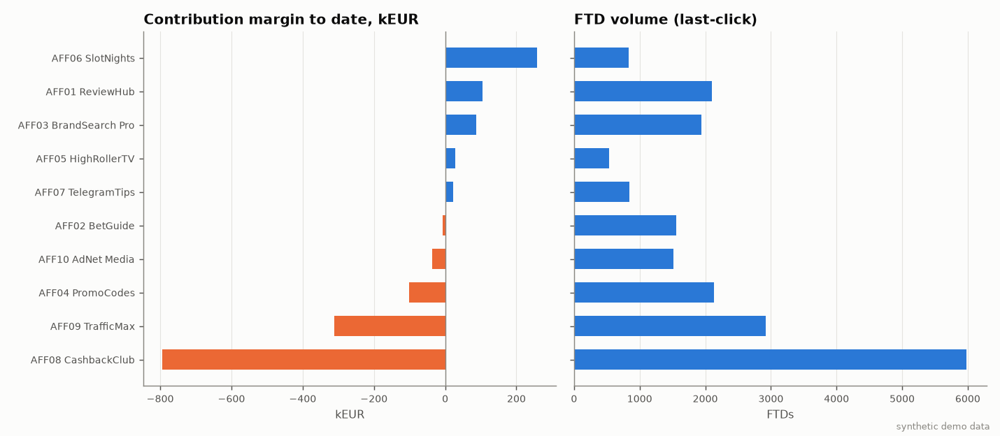
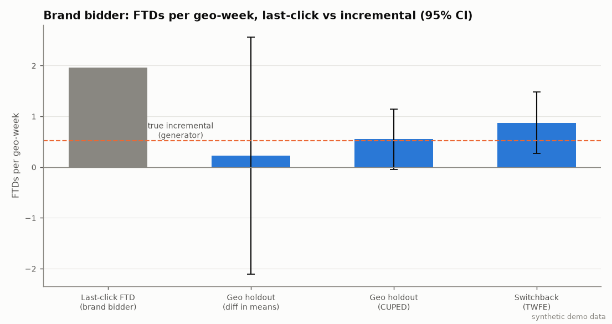
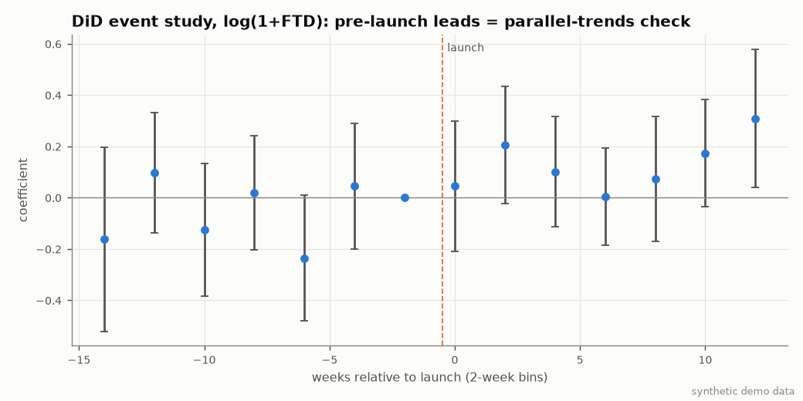
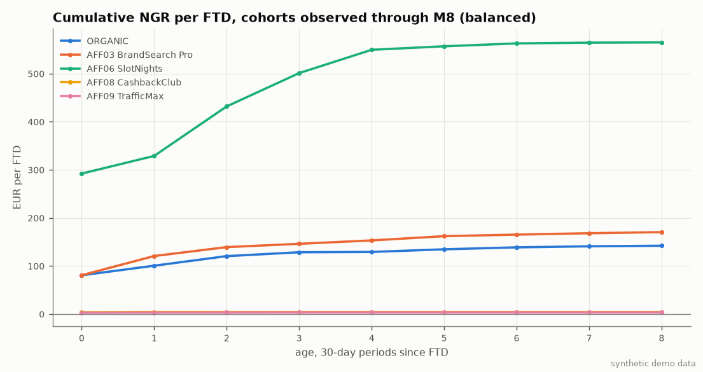
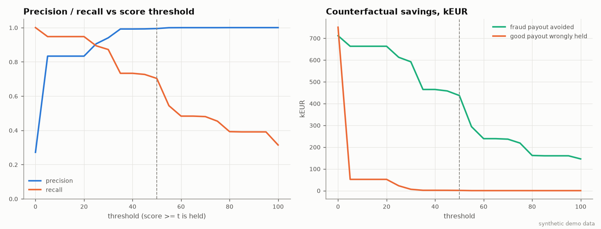

# Affiliate measurement stack — summary

> **SYNTHETIC DEMO DATA.** Все числа ниже получены на сгенерированном датасете (seed=42) и описывают только механику симуляции, а не реальный рынок, оператора или партнёров.

Период привлечения: 52 нед. с 2025-01-06; активность наблюдается до 2026-03-31. Игроков: 65,497, кликов: 367,598, депозитов: 193,224, player-day ставок: 195,183, гео: 40.

## 1. Воронка click → registration → KYC → FTD

| affiliate_id | name | clicks | registrations | kyc_passed | ftd | click_to_reg | reg_to_kyc | reg_to_ftd | avg_ftd_amount |
|---|---|---|---|---|---|---|---|---|---|
| AFF01 | ReviewHub | 41,826 | 4,951 | 4,212 | 2,098 | 11.8% | 85.1% | 42.4% | 72.6 |
| AFF02 | BetGuide | 30,720 | 3,639 | 3,054 | 1,557 | 11.8% | 83.9% | 42.8% | 77.6 |
| AFF03 | BrandSearch Pro | 12,226 | 4,279 | 3,661 | 1,936 | 35.0% | 85.6% | 45.2% | 77.7 |
| AFF04 | PromoCodes | 23,985 | 4,797 | 3,975 | 2,131 | 20.0% | 82.9% | 44.4% | 60.9 |
| AFF05 | HighRollerTV | 26,967 | 1,618 | 1,286 | 529 | 6.0% | 79.5% | 32.7% | 169.6 |
| AFF06 | SlotNights | 41,350 | 2,481 | 1,968 | 828 | 6.0% | 79.3% | 33.4% | 208.2 |
| AFF07 | TelegramTips | 20,590 | 2,059 | 1,741 | 845 | 10.0% | 84.6% | 41.0% | 62.2 |
| AFF08 | CashbackClub | 22,147 | 8,859 | 7,462 | 5,984 | 40.0% | 84.2% | 67.5% | 23.4 |
| AFF09 | TrafficMax | 86,900 | 4,345 | 2,397 | 2,919 | 5.0% | 55.2% | 67.2% | 22.7 |
| AFF10 | AdNet Media | 60,887 | 4,871 | 3,924 | 1,518 | 8.0% | 80.6% | 31.2% | 46.9 |
| ORGANIC | (organic) | — | 23,598 | 20,321 | 11,076 | — | 86.1% | 46.9% | 76.1 |

## 2. FTD-когорты с фиксированными окнами

NGR на FTD за D7/D30/D90 от даты FTD; окно учитывается только для когорт, у которых оно полностью наблюдено. Retention = доля FTD с активностью (ставкой) в днях 8–30 и 31–90. Среднее по когортам, веса = число FTD.

| affiliate_id | ngr_d7 | ngr_d30 | ngr_d90 | retention_d8_30 | retention_d31_90 | chargeback_rate_d90 | cohorts_d90 | cb_rate_all |
|---|---|---|---|---|---|---|---|---|
| AFF01 | 32.8 | 76.9 | 119.2 | 57.9% | 37.5% | 0.3% | 11 | 0.4% |
| AFF02 | 36.6 | 79.8 | 86.2 | 62.1% | 37.9% | 0.2% | 11 | 0.4% |
| AFF03 | 38.0 | 80.0 | 134.8 | 60.3% | 37.5% | 0.2% | 8 | 0.3% |
| AFF04 | -4.0 | 24.1 | 64.2 | 57.5% | 33.8% | 0.2% | 11 | 0.4% |
| AFF05 | 111.3 | 69.3 | 217.6 | 63.3% | 35.9% | 0.3% | 11 | 0.4% |
| AFF06 | 133.0 | 301.4 | 486.9 | 58.3% | 36.6% | 0.3% | 11 | 0.5% |
| AFF07 | 22.5 | 52.4 | 95.5 | 59.8% | 37.1% | 0.3% | 11 | 0.4% |
| AFF08 | 2.7 | 3.3 | 3.7 | 6.8% | 2.2% | 0.7% | 11 | 0.7% |
| AFF09 | 2.0 | 2.6 | 3.1 | 4.8% | 1.5% | 33.3% | 11 | 32.5% |
| AFF10 | 18.7 | 27.2 | 48.9 | 55.5% | 29.0% | 0.3% | 11 | 0.3% |
| ORGANIC | 29.7 | 66.0 | 110.1 | 59.4% | 38.9% | 0.3% | 11 | 0.4% |

## 3. Контракты и инвойсы

Месячные инвойсы: `invoices.csv` (150 строк, 15 месяцев).

| affiliate_id | contract | ftd | qftd | qftd_over_cap | cpa_payable | rs_payable | total_payable | qftd_rate |
|---|---|---|---|---|---|---|---|---|
| AFF01 | RevShare | 2,098 | 0 | 0 | 0.0 | 66,132.0 | 66,132.0 | — |
| AFF02 | Hybrid | 1,557 | 1,129 | 0 | 56,450.0 | 20,304.0 | 76,754.0 | 72.5% |
| AFF03 | CPA | 1,936 | 1,562 | 0 | 117,150.0 | 0.0 | 117,150.0 | 80.7% |
| AFF04 | CPA | 2,131 | 1,658 | 0 | 99,480.0 | 0.0 | 99,480.0 | 77.8% |
| AFF05 | RevShare | 529 | 0 | 0 | 0.0 | 87,590.6 | 87,590.6 | — |
| AFF06 | Hybrid | 828 | 649 | 0 | 38,940.0 | 98,296.4 | 137,236.4 | 78.4% |
| AFF07 | RevShare | 845 | 0 | 0 | 0.0 | 18,945.9 | 18,945.9 | — |
| AFF08 | CPA | 5,984 | 5,151 | 0 | 618,120.0 | 0.0 | 618,120.0 | 86.1% |
| AFF09 | CPA | 2,919 | 1,466 | 0 | 161,260.0 | 0.0 | 161,260.0 | 50.2% |
| AFF10 | CPA | 1,518 | 819 | 0 | 49,140.0 | 0.0 | 49,140.0 | 54.0% |

Отрицательные месяцы RevShare (net revenue < 0) и перенос:

| affiliate_id | month | contract | net_revenue_gross | carryover_in | net_revenue | rs_payable | carryover_out |
|---|---|---|---|---|---|---|---|
| AFF01 | 2025-02 | RevShare | -1,422.1 | 0.0 | -1,422.1 | 0.0 | -1,422.1 |
| AFF02 | 2025-05 | Hybrid | -52,468.9 | 0.0 | -52,468.9 | 0.0 | -52,468.9 |
| AFF02 | 2025-10 | Hybrid | -6,151.7 | 0.0 | -6,151.7 | 0.0 | -6,151.7 |
| AFF05 | 2025-04 | RevShare | -78,828.2 | 0.0 | -78,828.2 | 0.0 | 0.0 |
| AFF06 | 2025-03 | Hybrid | -23,565.8 | 0.0 | -23,565.8 | 0.0 | -23,565.8 |
| AFF07 | 2025-01 | RevShare | -148.6 | 0.0 | -148.6 | 0.0 | -148.6 |

What-if для AFF05 (HighRollerTV, RevShare, negative carryover по контракту = **off**): выплаты за период 87 591 EUR против 56 059 EUR при carryover=on; разница 31 531 EUR.

| month | net_revenue_gross | payable_carryover_off | payable_carryover_on | carryover_out_on |
|---|---|---|---|---|
| 2025-04 | -78,828.2 | 0.0 | 0.0 | -78,828.2 |
| 2025-05 | 22,584.6 | 9,033.8 | 0.0 | -56,243.6 |
| 2025-06 | 19,993.2 | 7,997.3 | 0.0 | -36,250.4 |
| 2025-07 | 27,567.1 | 11,026.8 | 0.0 | -8,683.3 |
| 2025-08 | 13,016.9 | 5,206.8 | 1,733.4 | 0.0 |

## 4. Contribution margin

`CM = NGR − affiliate payout − bonus cost − payment cost − chargebacks − variable ops`, где NGR = GGR − gaming tax − provider fees (бонусы — отдельной строкой). Всё время наблюдения (to date).

| affiliate_id | name | ftd | ngr | affiliate_payout | bonus_cost | payment_cost | chargeback_cost | variable_ops | cm | cm_per_ftd | payout_per_ftd | cm_after_fraud_hold |
|---|---|---|---|---|---|---|---|---|---|---|---|---|
| AFF01 | ReviewHub | 2,098 | 310,645 | 66,132 | 84,242 | 37,263 | 6,381 | 12,801 | 103,826 | 49 | 32 | 103,875 |
| AFF02 | BetGuide | 1,557 | 181,208 | 76,754 | 68,456 | 29,974 | 3,538 | 9,714 | -7,229 | -5 | 49 | -6,827 |
| AFF03 | BrandSearch Pro | 1,936 | 334,779 | 117,150 | 73,049 | 40,772 | 3,821 | 11,990 | 87,996 | 45 | 61 | 91,221 |
| AFF04 | PromoCodes | 2,131 | 150,466 | 99,480 | 107,658 | 28,111 | 4,001 | 12,428 | -101,213 | -47 | 47 | -97,433 |
| AFF05 | HighRollerTV | 529 | 175,339 | 87,591 | 31,599 | 21,018 | 3,847 | 3,126 | 28,159 | 53 | 166 | 28,159 |
| AFF06 | SlotNights | 828 | 494,815 | 137,236 | 50,077 | 38,442 | 5,756 | 4,865 | 258,438 | 312 | 166 | 258,438 |
| AFF07 | TelegramTips | 845 | 88,604 | 18,946 | 26,247 | 14,211 | 2,005 | 4,956 | 22,240 | 26 | 22 | 22,252 |
| AFF08 | CashbackClub | 5,984 | 21,856 | 618,120 | 161,930 | 11,772 | 1,939 | 21,874 | -793,781 | -133 | 103 | -507,581 |
| AFF09 | TrafficMax | 2,919 | 9,000 | 161,260 | 103,429 | 5,587 | 40,227 | 10,508 | -312,011 | -107 | 55 | -167,911 |
| AFF10 | AdNet Media | 1,518 | 83,968 | 49,140 | 48,121 | 13,770 | 1,804 | 8,172 | -37,038 | -24 | 32 | -37,038 |
| ORGANIC | (organic) | 11,076 | 1,483,504 | 0 | 431,450 | 208,750 | 37,560 | 69,598 | 736,145 | 66 | 0 | 736,145 |

**Высокий FTD volume ≠ прибыль.** AFF08 (CashbackClub) — крупнейший партнёр по FTD (5,984), но CM = -793 781 EUR (-133 EUR на FTD): NGR на FTD 3.7 EUR при выплате 103 EUR на FTD и бонусах 27 EUR на FTD. Даже если удержать выплаты по игрокам, отмеченным fraud-правилами, CM остаётся -507 581 EUR.

CM в фиксированном окне D90 (только игроки с полностью наблюдённым окном; RevShare-выплаты — по месяцам, начавшимся до FTD+90):

| affiliate_id | ftd | ngr | affiliate_payout | cm | cm_per_ftd | payout_per_ftd |
|---|---|---|---|---|---|---|
| AFF01 | 2,064 | 253,938.0 | 56,210.2 | 74,991.8 | 36.3 | 27.2 |
| AFF02 | 1,533 | 147,524.6 | 71,866.0 | -20,927.1 | -13.7 | 46.9 |
| AFF03 | 1,881 | 252,541.2 | 113,625.0 | 30,660.0 | 16.3 | 60.4 |
| AFF04 | 2,098 | 129,971.8 | 98,100.0 | -106,506.3 | -50.8 | 46.8 |
| AFF05 | 519 | 120,829.3 | 71,799.4 | -3,382.7 | -6.5 | 138.3 |
| AFF06 | 811 | 405,545.4 | 122,797.0 | 194,827.0 | 240.2 | 151.4 |
| AFF07 | 831 | 77,310.6 | 16,401.6 | 18,529.5 | 22.3 | 19.7 |
| AFF08 | 5,901 | 21,350.1 | 609,960.0 | -783,091.8 | -132.7 | 103.4 |
| AFF09 | 2,909 | 8,670.8 | 160,380.0 | -310,934.3 | -106.9 | 55.1 |
| AFF10 | 1,492 | 72,878.3 | 48,360.0 | -42,550.4 | -28.5 | 32.4 |
| ORGANIC | 10,890 | 1,213,807.1 | 0.0 | 580,664.1 | 53.3 | 0.0 |

## 5. Incrementality: brand bidding (AFF03 BrandSearch Pro)

Outcome — FTD (в течение 14 дней после регистрации) по brand-search пути: ORGANIC + brand bidder + coupon, на уровне geo × week. Эффект = сколько FTD в неделю в гео добавляет включённый brand bidder.

- Last-click: brand bidder получает **1.96** FTD на geo-week (в гео, где он включён).
- Geo holdout (28 гео on / 12 off, 13 недель): diff in means 0.22 [-2.11; 2.56], p=0.846; CUPED (ковариата — pre-period): 0.55 [-0.05; 1.14], p=0.069 → incremental share ≈ 28%.
- Switchback (рандомизация geo × week, 520 ячеек, TWFE, cluster SE по гео): 0.87 [0.26; 1.48], p=0.006 → incremental share ≈ 38%.
- DiD (level; ранний запуск в 12 крупнейших гео — неслучайно): ATT 1.514 [1.051; 1.977], p=0.000; pre-trend slope 0.024 [-0.131; 0.179], p=0.754; joint test leads p=0.262 → parallel trends не отвергается.
- DiD (log; ранний запуск в 12 крупнейших гео — неслучайно): ATT 0.160 [0.092; 0.227], p=0.000; pre-trend slope 0.001 [-0.018; 0.021], p=0.887; joint test leads p=0.108 → parallel trends не отвергается.
- Истинная доля инкрементальных FTD brand bidder в генераторе (ground truth, только для проверки): **26%**.

Last-click vs incremental экономика brand bidder (CM до выплаты на FTD берётся из раздела 4):

| view | lastclick_ftd | incremental_share | incremental_ftd | payout | cost_per_lastclick_ftd | cost_per_incremental_ftd | lastclick_cm | incremental_cm |
|---|---|---|---|---|---|---|---|---|
| last-click (tracking) | 1,936 | 100.0% | 1,936 | 117,150 | 60.5 | 60.5 | 87,996 | 87,996 |
| geo holdout, CUPED | 1,936 | 27.9% | 541 | 117,150 | 60.5 | 216.5 | 87,996 | -59,822 |
| switchback, TWFE | 1,936 | 37.8% | 732 | 117,150 | 60.5 | 160.1 | 87,996 | -39,617 |

Overlap: доля FTD партнёра, у которых за 30 дней до регистрации был organic/brand-search touchpoint или клик другого партнёра (device stitching):

| affiliate_id | name | ftd | share_organic_touch | share_brand_search | share_other_affiliate | share_any_overlap |
|---|---|---|---|---|---|---|
| AFF01 | ReviewHub | 2,098 | 5.3% | 2.7% | 1.0% | 6.3% |
| AFF02 | BetGuide | 1,557 | 5.9% | 3.2% | 0.8% | 6.7% |
| AFF03 | BrandSearch Pro | 1,936 | 74.9% | 74.3% | 0.9% | 74.9% |
| AFF04 | PromoCodes | 2,131 | 36.7% | 34.4% | 21.4% | 56.3% |
| AFF05 | HighRollerTV | 529 | 5.5% | 2.5% | 0.0% | 5.5% |
| AFF06 | SlotNights | 828 | 5.2% | 2.7% | 0.0% | 5.2% |
| AFF07 | TelegramTips | 845 | 5.7% | 2.6% | 0.8% | 6.5% |
| AFF08 | CashbackClub | 5,984 | 6.1% | 3.2% | 0.0% | 6.1% |
| AFF09 | TrafficMax | 2,919 | 6.0% | 3.2% | 0.1% | 6.1% |
| AFF10 | AdNet Media | 1,518 | 6.5% | 3.0% | 0.6% | 7.1% |

## 6. LTV forecast и backtest

Backtest без look-ahead: для каждой когорты (сегмент ALL) прогноз cumulative NGR/FTD на возраст M5 по первым 3 месяцам; chain ladder использует только ячейки других когорт, доступные на дату прогноза.

| model | cohorts | mape | bias |
|---|---|---|---|
| observed | 5 | 15.8% | -15.8% |
| power_decay | 5 | 10.8% | 10.8% |
| chain_ladder | 5 | 3.8% | -1.3% |

Прогноз LTV12 (NGR на FTD, chain ladder; факторы сегмента, если за ними ≥3 когорт, иначе ALL):

| segment | name | ftd | ngr_m3_per_ftd | ltv12_ngr_per_ftd | cpa_amount |
|---|---|---|---|---|---|
| AFF01 | ReviewHub | 2,098 | 119.2 | 154.0 | — |
| AFF02 | BetGuide | 1,557 | 86.2 | 131.6 | 50.0 |
| AFF03 | BrandSearch Pro | 1,936 | 134.8 | 184.5 | 75.0 |
| AFF04 | PromoCodes | 2,131 | 64.2 | 74.1 | 60.0 |
| AFF05 | HighRollerTV | 529 | 217.6 | 404.9 | — |
| AFF06 | SlotNights | 828 | 486.9 | 618.3 | 60.0 |
| AFF07 | TelegramTips | 845 | 95.5 | 107.6 | — |
| AFF08 | CashbackClub | 5,984 | 3.7 | 3.6 | 120.0 |
| AFF09 | TrafficMax | 2,919 | 3.1 | 3.0 | 110.0 |
| AFF10 | AdNet Media | 1,518 | 48.9 | 55.9 | 60.0 |
| ALL |  | 31,421 | 85.6 | 111.3 | — |
| ORGANIC | (organic) | 11,076 | 110.1 | 140.3 | — |

## 7. Fraud scoring (интерпретируемый)

Правила и веса (score = сумма весов сработавших правил, максимум 100):

| rule | weight | description | fires | precision | recall |
|---|---|---|---|---|---|
| DUP_DEVICE | 20 | device fingerprint shared by >= 2 registered accounts | 4,284 | 0.850 | 0.427 |
| DUP_PAYMENT | 25 | payment fingerprint used by >= 2 accounts | 4,347 | 0.975 | 0.497 |
| FAST_CLICK_REG | 20 | click -> registration in < 10 seconds | 2,727 | 0.985 | 0.315 |
| BURST | 20 | >= 5 registrations from the same sub_id within +-10 minutes | 2,439 | 1.000 | 0.286 |
| LOW_WAGER_DIVERSITY | 30 | one game only and stake < 3x deposits in first 30 days | 7,601 | 0.941 | 0.838 |
| COORD_WITHDRAWAL | 25 | >= 4 accounts of the same affiliate withdrew within +-30 minutes | 3,052 | 0.922 | 0.330 |
| HIGH_BONUS_RATIO | 20 | bonus / deposits >= 1.25 in first 30 days | 6,094 | 0.969 | 0.692 |

Precision/recall считаются по ground truth генератора; scorer к меткам доступа не имеет.

| threshold | flagged | precision | recall | fraud_payout_avoided | good_payout_held | net_savings | fraud_payout_share_caught |
|---|---|---|---|---|---|---|---|
| 20 | 9,699 | 0.833 | 0.947 | 662,980 | 51,708 | 611,272 | 0.932 |
| 30 | 7,910 | 0.940 | 0.872 | 591,700 | 6,142 | 585,558 | 0.832 |
| 40 | 6,305 | 0.992 | 0.733 | 464,500 | 1,585 | 462,915 | 0.653 |
| 50 | 6,032 | 0.995 | 0.703 | 436,780 | 989 | 435,791 | 0.614 |
| 60 | 4,121 | 1.000 | 0.483 | 238,660 | 60 | 238,600 | 0.335 |
| 80 | 3,347 | 1.000 | 0.392 | 161,495 | 0 | 161,495 | 0.227 |

Рабочий порог 50: в manual review queue 6,032 игроков (`review_queue.csv`, сортировка по score × payout at stake); precision 0.995, recall 0.703; удержано выплат по fraud 436 780 EUR, ошибочно удержано у честных игроков 989 EUR.

Sub-ID с наибольшей долей отмеченных FTD:

| affiliate_id | sub_id | ftd | flagged | avg_score | flagged_share |
|---|---|---|---|---|---|
| AFF09 | AFF09_s1 | 1,372 | 1,372 | 100.0 | 100.0% |
| AFF09 | AFF09_s2 | 1,297 | 1,297 | 100.0 | 100.0% |
| AFF08 | AFF08_s2 | 1,770 | 949 | 43.1 | 53.6% |
| AFF08 | AFF08_s3 | 1,742 | 882 | 41.4 | 50.6% |
| AFF08 | AFF08_s1 | 1,713 | 862 | 41.3 | 50.3% |
| AFF10 | AFF10_s7 | 72 | 6 | 8.3 | 8.3% |
| AFF10 | AFF10_s3 | 222 | 14 | 7.2 | 6.3% |
| AFF01 | AFF01_s6 | 136 | 8 | 7.9 | 5.9% |

## 8. Сверка инвойсов (partner report vs internal)

Партнёрский отчёт (синтетический) считает FTD по своему трекингу, режет месяц по UTC+3 и содержит дубликаты, неизвестные click_id и устаревшие ставки. Каждая претензия получает первую сработавшую причину.

| status | claims | claimed | payable | disputed |
|---|---|---|---|---|
| AMOUNT_MISMATCH | 320 | 31,420 | 25,020 | 6,400 |
| DUPLICATE_CLAIM | 337 | 30,500 | 0 | 30,500 |
| FRAUD_HOLD | 3,735 | 432,090 | 0 | 432,090 |
| MATCHED | 7,756 | 634,005 | 634,005 | 0 |
| NOT_LAST_CLICK | 186 | 9,420 | 0 | 9,420 |
| NOT_QUALIFIED | 4,355 | 386,680 | 0 | 386,680 |
| PERIOD_MISMATCH | 376 | 29,500 | 29,240 | 260 |
| UNCLAIMED_BY_PARTNER | 172 | 0 | 14,520 | -14,520 |
| UNKNOWN_CLICK | 858 | 91,300 | 0 | 91,300 |

| affiliate_id | claims | claimed | payable | disputed_share |
|---|---|---|---|---|
| AFF02 | 1,797 | 91,470 | 55,250 | 39.6% |
| AFF03 | 1,957 | 148,355 | 111,675 | 24.7% |
| AFF04 | 2,178 | 132,320 | 94,080 | 28.9% |
| AFF06 | 837 | 50,840 | 37,920 | 25.4% |
| AFF08 | 6,454 | 778,780 | 324,720 | 58.3% |
| AFF09 | 3,145 | 348,530 | 16,500 | 95.3% |
| AFF10 | 1,555 | 94,620 | 48,120 | 49.1% |

## 9. CRM guardrails

Кампания реактивации: 4,898 депозиторов без ставок 30–120 дней на 2026-03-31. Перед экспортом аудитории применяются self-exclusion, cool-off, согласие по каналу (fail closed), частотные лимиты за 7 дней и минимальный интервал.

| reason | email | sms | push |
|---|---|---|---|
| SELF_EXCLUDED | 69 | 69 | 69 |
| COOL_OFF | 96 | 96 | 96 |
| NO_CONSENT | 1,292 | 2,920 | 2,345 |
| CHANNEL_CAP | 175 | 419 | 61 |
| GLOBAL_CAP | 42 | 17 | 34 |
| MIN_GAP | 395 | 158 | 288 |
| EXPORTED | 2,829 | 1,219 | 2,005 |

Файлы: `crm_suppression_summary.csv`, `crm_audience_export_email.csv`.
